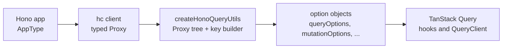
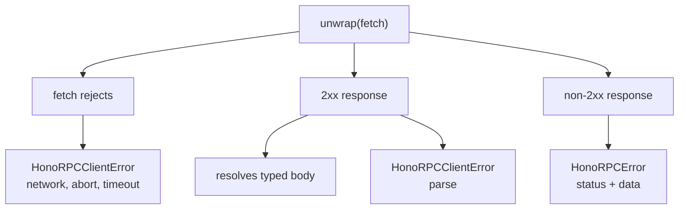

# @dorra/hono-rpc-tanstack-query

**Type-safe [TanStack Query](https://tanstack.com/query) utilities for the [Hono RPC client](https://hono.dev/docs/guides/rpc) (`hc`).**
Give it your `hc` client and get `queryOptions`, `mutationOptions`, typed query keys, typed cache helpers and an `error` whose type
comes from the errors your routes actually declare. Works with React, Vue, Solid and Svelte.

[](https://www.npmjs.com/package/@dorra/hono-rpc-tanstack-query)
[](https://github.com/its-dorra/hono-rpc-tanstack-query/actions/workflows/ci.yml)
[](https://www.npmjs.com/package/@dorra/hono-rpc-tanstack-query)
[](./LICENSE)

```ts
// server: declare the errors your route can return
const app = new Hono().get("/posts/:id", (c) => {
  const post = find(c.req.param("id"));
  if (!post) return c.json({ message: "not found" }, 404);
  return c.json(post);
});
export type AppType = typeof app;

// client
const api = createHonoQueryUtils(hc<AppType>("/api"));

const { data, error } = useQuery(
  api.posts[":id"].$get.queryOptions({ input: { param: { id } } }),
);
//      ^ Post | undefined            ^ HonoRPCError<404, { message: string }> | HonoRPCError<other statuses, unknown> | HonoRPCClientError | null

if (error instanceof HonoRPCError && error.status === 404) error.data.message; // string
```

Inspired by [`@orpc/tanstack-query`](https://orpc.unnoq.com/docs/integrations/tanstack-query).

## Contents

- [Why](#why) · [Features](#features) · [Install](#install) · [Quick start](#quick-start)
- Guides: [Queries](#queries) · [Mutations](#mutations) · [Infinite queries](#infinite-queries) · [Errors](#errors) ·
  [`safeCall` and Result libraries](#safecall-and-result-libraries) · [Mapping errors](#mapping-errors) · [Default options](#default-options) ·
  [Retries](#retries) · [Keys](#keys) · [Cache helpers](#cache-helpers) · [URLs](#urls) · [Cancellation and timeouts](#cancellation-and-timeouts) ·
  [Frameworks](#frameworks) · [SSR and prefetching](#ssr-and-prefetching)
- [API reference](#api-reference) · [How it works](#how-it-works) · [Troubleshooting](#troubleshooting) · [Compatibility](#compatibility) ·
  [Limits](#limits) · [Development](#development) · [License](#license)

## Why

`hc` gives you a typed client, but using it with TanStack Query by hand means writing query keys, `queryFn`s and error handling for
every endpoint, and the error type is just `Error`. Because Hono's client resolves (instead of rejecting) on 404/500, a plain
`queryFn: () => client.posts[':id'].$get(...)` also never reaches TanStack's error channel unless you unwrap the response yourself.

This library does that once, generically, and keeps every type that Hono already infers:

| You write                                       | You get                                                               |
| ----------------------------------------------- | --------------------------------------------------------------------- |
| `api.posts[':id'].$get.queryOptions({ input })` | typed `queryKey`, `queryFn`, abort-signal wiring, response unwrapping |
| a route that returns `c.json({ message }, 404)` | `error.status === 404` narrows `error.data` to `{ message: string }`  |
| `api.posts.$post.mutationOptions()`             | typed variables (`json`, `param`, ...), typed data and error          |
| `api.posts.$invalidate(queryClient)`            | prefix invalidation over a hierarchical key tree                      |
| `post.setData(queryClient, { input, updater })` | typed optimistic updates                                              |

## Features

- **Everything inferred from Hono**: no codegen, no schema duplication. The library derives its types from the client's own type.
- **Typed `error`** in `useQuery`, `useMutation`, `useInfiniteQuery` and `queryClient` state, from your routes' declared responses.
- **Plain option objects**, not hooks: works with React, Vue, Solid, Svelte, `queryClient.fetchQuery`, loaders and SSR.
- **`safeCall`** (errors as values) plus optional **neverthrow** and **better-result** adapters.
- **`mapError`** to convert errors into your own tagged error type at a single boundary.
- **Default options** for requests (static or per route) and for queries/mutations.
- **Typed cache helpers**: `getData`, `setData`, `cancel`, `invalidate`, `fetch`, `prefetch`, `ensureData`.
- **Hierarchical keys** that work with TanStack's partial matching; `skipToken`, `select` and infinite queries supported.
- Cancellation, `AbortSignal.timeout()` classification, `$url` / `$path` pass-through, stable node identity.
- Tiny runtime (one proxy, ~200 lines), zero dependencies, ESM + CJS, 100% test coverage.

## Install

```bash
npm i @dorra/hono-rpc-tanstack-query
```

Peer dependencies (you already have them in a Hono + TanStack Query app):

| Package                | Range                                                                        |
| ---------------------- | ---------------------------------------------------------------------------- |
| `hono`                 | `^4.7.0`                                                                     |
| `@tanstack/query-core` | `^5.62.0` (installed by every `@tanstack/*-query` adapter)                   |
| `neverthrow`           | `^8.0.0`, only for `@dorra/hono-rpc-tanstack-query/neverthrow` (optional)    |
| `better-result`        | `^3.0.0`, only for `@dorra/hono-rpc-tanstack-query/better-result` (optional) |

Make sure your project resolves **one** copy of `@tanstack/query-core` (see [Troubleshooting](#troubleshooting)).

## Quick start

**1. Server.** Export the app type, and declare error responses with an explicit status:

```ts
// server/app.ts
import { Hono } from "hono";
import { zValidator } from "@hono/zod-validator";
import { z } from "zod";

export const app = new Hono()
  .get("/posts", (c) => c.json({ items: listPosts() }))
  .get("/posts/:id", (c) => {
    const post = findPost(c.req.param("id"));
    if (!post) return c.json({ message: "not found" }, 404); // becomes HonoRPCError<404, { message: string }>
    return c.json(post);
  })
  .post(
    "/posts",
    zValidator("json", z.object({ title: z.string().min(1) })),
    (c) => {
      const post = createPost(c.req.valid("json"));
      return c.json(post, 201);
    },
  );

export type AppType = typeof app;
```

**2. Client.** Create the utils once:

```ts
// lib/api.ts
import { hc } from "hono/client";
import { createHonoQueryUtils } from "@dorra/hono-rpc-tanstack-query";
import type { AppType } from "../server/app";

export const api = createHonoQueryUtils(hc<AppType>("/api"));
```

**3. Use it** (React shown; see [Frameworks](#frameworks) for Vue, Solid and Svelte):

```tsx
import { useMutation, useQuery, useQueryClient } from "@tanstack/react-query";
import { HonoRPCError } from "@dorra/hono-rpc-tanstack-query";

function Post({ id }: { id: string }) {
  const queryClient = useQueryClient();
  const { data, error } = useQuery(
    api.posts[":id"].$get.queryOptions({ input: { param: { id } } }),
  );

  const create = useMutation(
    api.posts.$post.mutationOptions({
      onSuccess: () => api.posts.$invalidate(queryClient),
    }),
  );

  if (error instanceof HonoRPCError && error.status === 404)
    return <p>{error.data.message}</p>;
  return <h1>{data?.title}</h1>;
}
```

The utils mirror the client: `client.posts[':id'].$get` becomes `api.posts[':id'].$get`, and its `input` is exactly what the
client method takes (`{ param, query, json, header, form }`).

## Queries

```ts
useQuery(api.posts[":id"].$get.queryOptions({ input: { param: { id } } }));
useQuery(api.health.$get.queryOptions()); // input is optional when the route has none
useQuery(
  api.posts[":id"].$get.queryOptions({
    input: { param: { id } },
    staleTime: 30_000,
  }),
);
useQuery(
  api.posts[":id"].$get.queryOptions({
    input: { param: { id } },
    select: (p) => p.title,
  }),
);
useSuspenseQuery(
  api.posts[":id"].$get.queryOptions({ input: { param: { id } } }),
);
```

Disable a query until its input exists with `skipToken` (accepted by `useQuery`, rejected at compile time by suspense hooks):

```ts
import { skipToken } from "@tanstack/react-query";
useQuery(
  api.posts[":id"].$get.queryOptions({
    input: id ? { param: { id } } : skipToken,
  }),
);
```

`queryOptions` accepts every TanStack option except `queryKey` and `queryFn`, plus `client` for per-call request options
(headers, `fetch`, `init`). `select` is typed with the route's output and changes the type seen by the hook, not the cached type.

## Mutations

```ts
const create = useMutation(
  api.posts.$post.mutationOptions({
    onSuccess: (post) => api.posts.$invalidate(queryClient),
    onError: (error) => {
      /* typed, see Errors */
    },
  }),
);

create.mutate({ json: { title: "Hello" } });
```

Variables are the endpoint's input. Endpoints whose input is optional can be mutated with `mutate()` and no arguments.

## Infinite queries

```ts
useInfiniteQuery(
  api.posts.$get.infiniteOptions({
    input: (cursor: string | undefined) => ({ query: { cursor } }),
    initialPageParam: undefined,
    getNextPageParam: (last) => last.nextCursor ?? undefined,
  }),
);
```

`input` builds the endpoint input from a page param and should be pure (it is called once at construction to build the key).
`skipToken` is accepted as `input`.

## Errors

Every failure is normalised into one of two classes, so the `error` you receive is a closed union:

| Class                        | When                        | Fields                                                          |
| ---------------------------- | --------------------------- | --------------------------------------------------------------- |
| `HonoRPCError<status, data>` | the server answered non-2xx | `status`, `data` (parsed body), `response`                      |
| `HonoRPCClientError`         | no usable response          | `reason: 'network' \| 'abort' \| 'timeout' \| 'parse'`, `cause` |

For a route, the type of `error` is:

```
HonoRPCError<each declared status, its declared body>   // from c.json(..., 404), c.json(..., 409), ...
| HonoRPCError<every other error status, unknown>        // statuses the route does not declare (500, 502, ...)
| HonoRPCClientError
```

```ts
const { error } = useQuery(
  api.posts[":id"].$get.queryOptions({ input: { param: { id } } }),
);

if (error instanceof HonoRPCError) {
  // or isHonoRPCError(error)
  if (error.status === 404)
    error.data.message; // typed: { message: string }
  else error.data; // unknown
} else if (error) {
  error.reason; // 'network' | 'abort' | 'timeout' | 'parse'
}
```

Notes:

- Declared statuses are removed from the "undeclared" member, so `error.status === 404` narrows `data` precisely.
- Error bodies are best-effort: a malformed or empty error body never hides the status (`data` is the raw text, or `undefined`).
- 2xx bodies are parsed strictly: invalid JSON becomes a `parse` client error. 204 and 205 resolve to `undefined`.
- **Validator middleware does not declare its 400 by itself** (for example `@hono/zod-validator`). Without a hook, a 400 is typed as an
  undeclared status with an `unknown` body. Return it from the validator hook to type it:
  `zValidator('json', schema, (result, c) => { if (!result.success) return c.json({ error: 'invalid' as const }, 400) })`.
- `isHonoRPCError` and `isHonoRPCClientError` are type guards that keep the union intact when you already hold a typed `error`.
- Cancellations are `reason: 'abort'`; an `AbortSignal.timeout()` that fires is `reason: 'timeout'`.

## `safeCall` and Result libraries

`call` rejects on failure. `safeCall` never rejects: errors are values, with the same route-typed `error`.

```ts
const { data, error } = await api.posts[':id'].$get.safeCall({ param: { id } })
// or
const result = await api.posts[':id'].$get.safeCall({ param: { id } })
if (result.ok) result.data /* Post */ else result.error /* the typed union */
```

### neverthrow and better-result

Neither library is a dependency; install the one you use. Both adapters are optional subpath exports, a few lines on top of `safeCall`.

```ts
import { toResultAsync } from "@dorra/hono-rpc-tanstack-query/neverthrow"; // peer: neverthrow >= 8

const title = await toResultAsync(
  api.posts[":id"].$get.safeCall({ param: { id } }),
)
  .map((post) => post.title)
  .mapErr((e) =>
    isHonoRPCError(e) && e.status === 404 ? "missing" : "failed",
  );
```

```ts
import { toResult } from "@dorra/hono-rpc-tanstack-query/better-result"; // peer: better-result >= 3

const result = await toResult(
  api.posts[":id"].$get.safeCall({ param: { id } }),
);
result.match({ ok: (post) => post.title, err: (e) => e.message });
```

`better-result` is ESM-only, so `@dorra/hono-rpc-tanstack-query/better-result` is ESM-only too (`require()` of it is blocked by the exports map).

## Mapping errors

Convert library errors into your own error type at one boundary. Whatever `mapError` returns becomes the `error` type of hooks,
`call`, `safeCall` and the cache state:

```ts
type AppError = { _tag: "NotFound" | "Offline" | "Unknown" };

const api = createHonoQueryUtils(client, {
  mapError: (error, { route, method }): AppError => {
    if (error instanceof HonoRPCClientError) return { _tag: "Offline" };
    return error.status === 404 ? { _tag: "NotFound" } : { _tag: "Unknown" };
  },
});
// useQuery(api.posts[':id'].$get.queryOptions(...)).error  ->  AppError | null
```

The trade-off is explicit: with a mapper you get _your_ union everywhere, but you lose the per-route status/body typing (the mapper
receives the generic `HonoRPCError | HonoRPCClientError`). The mapper must not throw; a throw is surfaced as-is.

## Default options

```ts
const api = createHonoQueryUtils(client, {
  defaults: {
    client: (ctx) => ({ headers: { "x-route": ctx.route.join("/") } }), // or a static object
    query: { staleTime: 30_000, gcTime: 5 * 60_000 }, // queryOptions + infiniteOptions
    mutation: { retry: 0 }, // mutationOptions
  },
});
```

- Call-site options win (shallow merge).
- `client.headers` are merged case-insensitively (static and function headers can be mixed); `client.init` is shallow-merged; `fetch` and the rest are replaced.
- `defaults.client` as a function runs per request with `{ route, method }`, so request options can vary per route.
- Only options that make sense across endpoints are accepted (no `select`, no keys).
- Alternative for query options: `queryClient.setQueryDefaults(api.posts.$key(), { staleTime })` works with this library's hierarchical keys and can change at runtime.

## Retries

This library does not implement retries; TanStack Query already does (`retry`, `retryDelay`), and doing it twice would multiply attempts.
What you get is a typed `error` inside those callbacks:

```ts
const api = createHonoQueryUtils(client, {
  defaults: {
    query: {
      // error: HonoRPCError | HonoRPCClientError  (or your mapped type)
      retry: (count, error) =>
        !(error instanceof HonoRPCError && error.status < 500) && count < 3,
      retryDelay: (count, error) =>
        error instanceof HonoRPCError && error.status === 429
          ? Number(error.response.headers.get("retry-after") ?? 1) * 1000
          : Math.min(1000 * 2 ** count, 30_000),
    },
  },
});
```

By default TanStack retries every failed query three times, including 404s. Retrying only 5xx and network failures, and honouring
`Retry-After`, are the two things worth configuring. Mutations are not retried by default; keep it that way unless the endpoint is idempotent.

## Keys

```ts
api.posts[":id"].$get.queryKey({ input: { param: { id } } }); // typed key for any QueryClient method
api.posts[":id"].$get.key(); // every input of this endpoint
api.posts.$key(); // prefix key: everything under /posts
api.$key(); // everything
```

A key looks like `[['posts', ':id', '$get'], { type: 'query', input }]`. `type` is `'query' | 'infinite' | 'mutation'`, so regular and
infinite queries of the same endpoint never collide. Keys are hashed by TanStack with sorted JSON, so input key order does not matter and
`undefined` fields are dropped. Inputs must therefore be JSON-serialisable (see [Limits](#limits)).

## Cache helpers

Thin, typed wrappers over `QueryClient` for one endpoint (the first argument is the client):

```ts
const post = api.posts[":id"].$get;
const input = { param: { id } };

post.getData(queryClient, { input }); // Post | undefined
post.setData(queryClient, {
  input,
  updater: (old) => old && { ...old, views: old.views + 1 },
});
await post.cancel(queryClient, { input }); // cancels exactly this input (before optimistic updates)
await post.invalidate(queryClient, { input }); // omit input to invalidate every input of the endpoint
await post.fetch(queryClient, { input, staleTime: 10_000 });
await post.prefetch(queryClient, { input }); // never throws
await post.ensureData(queryClient, { input }); // cached value, or fetch

await api.posts.$invalidate(queryClient); // everything under /posts
```

An optimistic update, end to end:

```ts
useMutation({
  mutationFn: (input: { param: { id: string } }) =>
    api.posts[":id"].$delete.call(input),
  onMutate: async (input) => {
    await api.posts.$get.cancel(queryClient, { input: { query: {} } });
    const previous = api.posts.$get.getData(queryClient, {
      input: { query: {} },
    });
    api.posts.$get.setData(queryClient, {
      input: { query: {} },
      updater: (old) =>
        old && {
          ...old,
          items: old.items.filter((p) => p.id !== input.param.id),
        },
    });
    return { previous };
  },
  onError: (_e, _input, context) => {
    if (context?.previous)
      api.posts.$get.setData(queryClient, {
        input: { query: {} },
        updater: context.previous,
      });
  },
  onSettled: () => api.posts.$invalidate(queryClient),
});
```

`invalidate` and `$invalidate` also accept TanStack's filters (`refetchType`, `type: 'active'`, ...). Our key discriminator is called
`keyType` there (`'query' | 'infinite' | 'mutation'`) because `type` is already TanStack's filter.

## URLs

Hono's own `$url` and `$path` are passed through untouched (same signature, same result):

```ts
api.posts[":id"].$url({ param: { id: "1" } }); // URL (needs an absolute base URL, as in Hono)
api.posts[":id"].$path({ param: { id: "1" } }); // '/posts/1' (route path only; works with a relative base)
```

## Cancellation and timeouts

TanStack's abort signal is forwarded to `fetch` and merged with any `init.signal` you pass (via `AbortSignal.any`, with a fallback where it
is unavailable). Cancellations surface as `reason: 'abort'`; an `AbortSignal.timeout()` that fires surfaces as `reason: 'timeout'`.

```ts
useQuery(
  api.reports.$get.queryOptions({
    client: { init: { signal: AbortSignal.timeout(10_000) } },
  }),
);
```

`api.posts.$get.call(input, options)` makes the same request without TanStack. Mutations cannot be cancelled (TanStack provides no signal for them).

## Frameworks

There is no framework-specific implementation: everything returned is a plain options object. What changes per framework is how you make
the options reactive, which is each adapter's own convention:

```ts
// React (@tanstack/react-query)
useQuery(api.posts[":id"].$get.queryOptions({ input: { param: { id } } }));

// Vue (@tanstack/vue-query): wrap in computed so refs are tracked
useQuery(
  computed(() =>
    api.posts[":id"].$get.queryOptions({ input: { param: { id: id.value } } }),
  ),
);

// Solid (@tanstack/solid-query): a thunk, reading signals inside
createQuery(() =>
  api.posts[":id"].$get.queryOptions({ input: { param: { id: id() } } }),
);

// Svelte 5 (@tanstack/svelte-query v6): a thunk, reading $state inside
createQuery(() =>
  api.posts[":id"].$get.queryOptions({ input: { param: { id } } }),
);
```

Static options (no reactive input) can be passed directly. `data`, `error`, `select`, `skipToken`, mutations and infinite queries are typed
the same way everywhere. Two things to know:

- **The returned _types_ omit eight options** whose function form takes a `Query` parameter: `enabled`, `staleTime`, `refetchInterval`,
  `refetchOnWindowFocus`, `refetchOnReconnect`, `refetchOnMount`, `retryOnMount` and `throwOnError`. Vue unwraps refs inside the key type,
  which makes it reject objects that declare them. You can still pass all of them as inputs and they are forwarded at runtime; they just aren't
  declared on the returned object's type.
- **Use a single copy of `@tanstack/query-core`** (see [Troubleshooting](#troubleshooting)).

Verified in this repository: React (runtime and types), Vue (types and runtime reactivity), Solid and Svelte (types only; their runtimes need a
component/compiler environment). Angular is untested.

## SSR and prefetching

Options and keys are plain, JSON-serialisable data, so TanStack's standard server-rendering patterns apply: prefetch with
`endpoint.prefetch(queryClient, { input })` (or `fetch` / `ensureData`), then dehydrate and hydrate as usual.
This repository's tests do not cover any SSR framework, so treat this as expected rather than verified behaviour.

## API reference

### `createHonoQueryUtils(client, options?)`

```ts
function createHonoQueryUtils<T extends object, TMapped = never>(
  client: T, // the result of hc<AppType>(...)
  options?: HonoQueryUtilsOptions<TMapped>,
): HonoQueryUtils<T, TMapped>;
```

| Option              | Type                                                                                                                                                                                    | Description                                                     |
| ------------------- | --------------------------------------------------------------------------------------------------------------------------------------------------------------------------------------- | --------------------------------------------------------------- |
| `mapError`          | `(error: HonoRPCError \| HonoRPCClientError, ctx: CallContext) => TMapped`                                                                                                              | Replace the error type (see [Mapping errors](#mapping-errors)). |
| `defaults.client`   | `ClientRequestOptions \| (ctx: CallContext) => ClientRequestOptions \| undefined`                                                                                                       | Request options for every call.                                 |
| `defaults.query`    | `{ staleTime, gcTime, retry, retryDelay, retryOnMount, refetchOnMount, refetchOnWindowFocus, refetchOnReconnect, refetchInterval, networkMode, throwOnError, meta, structuralSharing }` | Merged under `queryOptions` / `infiniteOptions`.                |
| `defaults.mutation` | `{ retry, retryDelay, networkMode, gcTime, meta, throwOnError }`                                                                                                                        | Merged under `mutationOptions`.                                 |

`CallContext` is `{ route: readonly string[]; method: 'get' | 'post' | 'put' | 'patch' | 'delete' | 'head' | 'options' }`.

### Tree shape

The returned object mirrors the client. Path segments (`posts`, `':id'`) are nodes; `$get`, `$post`, `$put`, `$patch`, `$delete`, `$head`
and `$options` are endpoints. Nodes and endpoints are cached, so `api.posts === api.posts`.

### Node members

| Member                                               | Description                                                          |
| ---------------------------------------------------- | -------------------------------------------------------------------- |
| `$key({ type? })`                                    | Prefix key for everything under this node.                           |
| `$invalidate(queryClient, { keyType?, ...filters })` | Invalidate everything under this node.                               |
| `$url(...)`, `$path(...)`                            | Hono's own helpers, passed through (only where the client has them). |

### Endpoint members

`Input` is `Parameters<endpoint>[0]` from Hono's client; `Output` is the parsed 2xx body; `Err` is the [error union](#errors) (or your mapped type).

| Member                                                              | Returns                            | Notes                                                                   |
| ------------------------------------------------------------------- | ---------------------------------- | ----------------------------------------------------------------------- |
| `call(input, options?)`                                             | `Promise<Output>`                  | Rejects with the typed error. `input` optional when the route has none. |
| `safeCall(input, options?)`                                         | `Promise<SafeResult<Output, Err>>` | Never rejects.                                                          |
| `key({ type?, input? })`                                            | `QueryKey`                         | Partial key for filters.                                                |
| `queryKey({ input })`                                               | `DataTag<QueryKey, Output, Err>`   | Typed key for `getQueryData` and friends.                               |
| `queryOptions({ input, client?, ...options })`                      | query options                      | `input` may be `skipToken`. `select` supported.                         |
| `infiniteOptions({ input, initialPageParam, client?, ...options })` | infinite query options             | `input` is `(pageParam) => Input` or `skipToken`.                       |
| `mutationKey()`                                                     | `QueryKey`                         |                                                                         |
| `mutationOptions({ client?, ...options })`                          | mutation options                   | Variables are `Input`; optional-input endpoints allow `mutate()`.       |
| `getData(qc, { input })`                                            | `Output \| undefined`              |                                                                         |
| `setData(qc, { input, updater })`                                   | `Output \| undefined`              | `updater` is a value or `(old) => new`.                                 |
| `cancel(qc, { input })`                                             | `Promise<void>`                    | Cancels exactly this input.                                             |
| `invalidate(qc, { input?, keyType?, ...filters })`                  | `Promise<void>`                    |                                                                         |
| `fetch(qc, { input, ...options })`                                  | `Promise<Output>`                  | `queryClient.fetchQuery`.                                               |
| `prefetch(qc, { input, ...options })`                               | `Promise<void>`                    | `queryClient.prefetchQuery`; never throws.                              |
| `ensureData(qc, { input, ...options })`                             | `Promise<Output>`                  | `queryClient.ensureQueryData`.                                          |

### Exports

```ts
import {
  createHonoQueryUtils,
  HonoRPCError,
  HonoRPCClientError,
  isHonoRPCError,
  isHonoRPCClientError,
  type HonoQueryUtils,
  type HonoQueryUtilsOptions,
  type EndpointUtils,
  type CallContext,
  type HttpMethod,
  type SafeResult,
  type LibraryError,
  type KeyType,
  type HonoRPCClientErrorReason,
  type InputOf,
  type OutputOf,
  type ErrorOf,
  type VariablesOf, // work on raw endpoints, e.g. OutputOf<typeof client.posts.$get>
} from "@dorra/hono-rpc-tanstack-query";

import { toResultAsync } from "@dorra/hono-rpc-tanstack-query/neverthrow";
import { toResult } from "@dorra/hono-rpc-tanstack-query/better-result"; // ESM only
```

## How it works



- **Wrapping the client, not `AppType`.** Types are derived from the client's own type, so there is nothing to keep in sync with Hono.
- **A lazy proxy tree.** Property access appends a path segment and returns a cached child; the real client is only walked, by path, when a
  request is made. Constructing options never touches the network.
- **One choke point for outcomes.** Every request goes through a single `unwrap` that turns the outcome into a parsed body, a
  `HonoRPCError`, or a `HonoRPCClientError`; nothing else can escape, which is what lets `error` be a closed union.



**Types.** For an endpoint function `Fn`, `Awaited<ReturnType<Fn>>` is a union of Hono's `ClientResponse<Body, Status, Format>`, one member
per response the route returns. A member whose status union contains any 2xx status is the _success_ response (this is decided per
member, not per status, because Hono types a handler's plain `c.json(x)` with a wide status union when a validator hook declares extra
responses). Members without a 2xx status become `HonoRPCError<status, body>`; an extra `HonoRPCError<Exclude<ErrorStatus, declared>, unknown>`
covers undeclared statuses so `error.status === 404` still narrows precisely. Query keys are branded with TanStack's `DataTag`, which is why
`getQueryData(endpoint.queryKey(...))` needs no casts.

## Troubleshooting

**Type errors that mention `Query`, `Mutation` or `QueryClient` not being assignable.** Two copies of `@tanstack/query-core` are installed.
Dedupe to one (`npm ls @tanstack/query-core`), for example with `overrides` (npm), `resolutions` (yarn) or `pnpm.overrides`.

**`error.status` does not narrow `error.data` in `catch` blocks or untyped code.** Narrowing works on the typed `error` from hooks and
`safeCall`. A bare `catch (e)` is `unknown`; use `isHonoRPCError(e)` first.

**A 400 from my validator has `data: unknown`.** Validator middleware does not declare its 400; return it from the validator hook (see [Errors](#errors)).

**`$url` throws `Invalid URL`.** Hono's `$url` needs an absolute base URL. Use `$path`, which works with a relative base such as `hc('/api')`.

**`queryOptions(...).staleTime` / `.enabled` is not on the returned type.** They are omitted from the returned types (see [Frameworks](#frameworks))
but still passed to TanStack at runtime.

**My route named `then` is unreachable.** A path segment literally called `then` would make the proxy thenable, so it is not supported.

**`invalidate(qc, { type: 'infinite' })` is rejected.** `type` is TanStack's filter (`'active' | 'inactive' | 'all'`); use `keyType`.

**Queries retry my 404s.** That is TanStack's default (three retries for everything). Configure `retry`, see [Retries](#retries).

## Compatibility

Tested with:

|                                                                      | Version                                               |
| -------------------------------------------------------------------- | ----------------------------------------------------- |
| Node.js (built bundle)                                               | 18.20, 20.0, 22 (test suite runs on 20, 22, 24 in CI) |
| TypeScript                                                           | 5.9                                                   |
| Hono                                                                 | 4.13                                                  |
| `@tanstack/query-core` and `react-query`, `vue-query`, `solid-query` | 5.108                                                 |
| `@tanstack/svelte-query`                                             | 6.4 (Svelte 5)                                        |
| `neverthrow` / `better-result`                                       | 8.2 / 3.0                                             |

Older versions inside the peer ranges are expected to work but are not part of the test matrix. The package ships ESM and CJS builds
(except `better-result`, ESM only) with bundled type declarations.

## Limits

- A route segment literally named `then` is unreachable through the utils.
- Only JSON and text responses are parsed; 204/205 resolve to `undefined`. Streaming and binary bodies are out of scope.
- Inputs go into the query key, so they must be JSON-serialisable. Use `mutationOptions` (or `call`) for `form` inputs containing `File`/`Blob`.
- `infiniteOptions` keys on `input(initialPageParam)` and calls `input` once at construction.
- Mutations cannot be cancelled.
- Only the HTTP method members, `$url` and `$path` are exposed from Hono's client; `$ws` is not.
- The returned option types omit eight options (see [Frameworks](#frameworks)); runtime behaviour is unchanged.
- With `mapError`, per-route status/body typing is replaced by your own error type.
- Type-check time on very large `AppType`s has not been benchmarked.

## Claude skill

The package ships an [Agent Skill](https://docs.claude.com/en/docs/agents-and-tools/agent-skills/overview) that teaches Claude how to use this
library: the mental model, the server-side contract that drives the error types, recipes, and common pitfalls. It lives in
[`skills/hono-rpc-tanstack-query`](./skills/hono-rpc-tanstack-query) in this repository and is included in the npm package.

```bash
# Claude Code, for this project
mkdir -p .claude/skills
cp -r node_modules/@dorra/hono-rpc-tanstack-query/skills/hono-rpc-tanstack-query .claude/skills/

# Claude Code, for every project
mkdir -p ~/.claude/skills && cp -r node_modules/@dorra/hono-rpc-tanstack-query/skills/hono-rpc-tanstack-query ~/.claude/skills/
```

For Claude.ai, download `hono-rpc-tanstack-query.skill` from the [latest GitHub Release](https://github.com/its-dorra/hono-rpc-tanstack-query/releases/latest)
and upload it in the Skills settings (see Anthropic's documentation for the current steps).

## Development

```bash
npm ci
npm test               # runtime, React + Vue hooks (jsdom), and type-level tests
npm run test:coverage  # 100% statements / branches / functions / lines
npm run typecheck
npm run build
npm run check:package  # publint + are-the-types-wrong
```

The source is three small modules: `src/runtime.ts` (proxy tree, keys, request handling), `src/types.ts` (type derivation) and
`src/errors.ts` (error classes and guards), plus the two adapter files. See [`PUBLISHING.md`](./PUBLISHING.md) for the release process and
[`CHANGELOG.md`](./CHANGELOG.md) for history.

## License

[MIT](./LICENSE)
